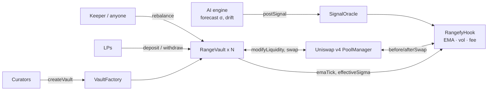

<p align="center"></p>

<h1 align="center">Rangefy</h1>

<p align="center"><b>AI-curated liquidity vaults on Uniswap v4.</b><br/>Curators define the strategy. An AI volatility model sizes the range. A v4 hook prices risk and guards every rebalance on-chain.</p>

<p align="center">
  <a href="https://rangefy.vercel.app"><b>Live App</b></a> ·
  <a href="https://youtu.be/REPLACE_WITH_DEMO"><b>Demo Video</b></a> ·
  <a href="https://REPLACE_WITH_PITCH_DECK"><b>Pitch Deck</b></a> ·
  <a href="docs/Rangefy.md"><b>Design Doc</b></a>
</p>

<p align="center">Uniswap Hook Incubator Hookathon · Theme: Active Management & Curation · Unichain Sepolia (1301)</p>

---

## The problem

Concentrated liquidity only earns while price is in range. Passive LPs drift out of range, pick the wrong width for the market, and earn a flat fee even when volatility makes them the exit liquidity for informed flow. Existing managers are either opaque off-chain bots or rigid on-chain rules.

## The solution

| Layer | What it does |
|---|---|
| **RangefyHook** (Uniswap v4) | EMA price + realized-vol oracle updated before every swap, dynamic fee per volatility regime, manipulation-resistant reference for vaults |
| **SignalOracle** | AI 24h sigma/drift forecast posted on-chain; bounded, expires after 15 min, hook falls back to on-chain vol |
| **RangeVault** | One curator strategy, one position, ERC-20 shares. Range computed on-chain; anyone can rebalance when rules allow |
| **AI engine** | Transformer + Random Forest ensemble, keeper bot, market mirror, FastAPI |
| **Frontend** | Vaults, deposit/withdraw, curate, leaderboard, AI signal, swap, faucet |



## Deployed contracts (Unichain Sepolia)

| Contract | Address |
|---|---|
| RangefyHook | [`0x30fC39443350EBaBE9Fdb8f289ED700379E170C0`](https://sepolia.uniscan.xyz/address/0x30fC39443350EBaBE9Fdb8f289ED700379E170C0) |
| SignalOracle | [`0x7987D735B66A3a45C29aE1c54d29c3d7f7E37AE2`](https://sepolia.uniscan.xyz/address/0x7987D735B66A3a45C29aE1c54d29c3d7f7E37AE2) |
| VaultFactory | [`0xc0c10945F008A57d80D1c1626D72B2BA0e9078cf`](https://sepolia.uniscan.xyz/address/0xc0c10945F008A57d80D1c1626D72B2BA0e9078cf) |
| VaultDeployer | [`0x161b5d7C308838A7F76Ee94cf776aB9a113C54A7`](https://sepolia.uniscan.xyz/address/0x161b5d7C308838A7F76Ee94cf776aB9a113C54A7) |
| CuratorRegistry | [`0xB1C34125317bc245e9b378Ff122A9BE1c890Da1f`](https://sepolia.uniscan.xyz/address/0xB1C34125317bc245e9b378Ff122A9BE1c890Da1f) |
| RangefyLens | [`0x79bEB2fC8e5b6e7D708dBB04D5D2a84619A0a515`](https://sepolia.uniscan.xyz/address/0x79bEB2fC8e5b6e7D708dBB04D5D2a84619A0a515) |
| SimpleSwapRouter | [`0xA1ed6529Ee0E217A6Ae10A82414EB02DCeaD914E`](https://sepolia.uniscan.xyz/address/0xA1ed6529Ee0E217A6Ae10A82414EB02DCeaD914E) |
| RangeMath (library) | [`0xa141DA83b56FD0B1f9E0446708A9B3Eb8220C52e`](https://sepolia.uniscan.xyz/address/0xa141DA83b56FD0B1f9E0446708A9B3Eb8220C52e) |
| mWETH (faucet, 18 dec) | [`0x6ed64B017cC45A17C802f4C90433b998F8cE0a8d`](https://sepolia.uniscan.xyz/address/0x6ed64B017cC45A17C802f4C90433b998F8cE0a8d) |
| mUSDC (faucet, 6 dec) | [`0xE1779A0cE6c57f7501d6A6cC526B43B338907912`](https://sepolia.uniscan.xyz/address/0xE1779A0cE6c57f7501d6A6cC526B43B338907912) |

| Vault | Curator · Profile | Address |
|---|---|---|
| Atlas Conservative (rfATL) | Atlas · 3.5σ, 1h cooldown, 5% fee | [`0xd990193de6cE199Bd80d8f3243dc2e942C3A2773`](https://sepolia.uniscan.xyz/address/0xd990193de6cE199Bd80d8f3243dc2e942C3A2773) |
| Harbor Balanced (rfHRB) | Harbor · 2σ, 15m cooldown, 10% fee | [`0x181B4c8A53d5fd3fC4f90c6Df3a6Aae125976ba0`](https://sepolia.uniscan.xyz/address/0x181B4c8A53d5fd3fC4f90c6Df3a6Aae125976ba0) |
| Vector Aggressive (rfVEC) | Vector · 1σ, 5m cooldown, 15% fee | [`0x59eD0b85337F611FD78B08FDC22022Fed8582299`](https://sepolia.uniscan.xyz/address/0x59eD0b85337F611FD78B08FDC22022Fed8582299) |

| Pool / external | Value |
|---|---|
| Pool (mWETH/mUSDC, dynamic fee, tick spacing 60) | `0x7adc65608ef0f7adfd4ef1c8aa43e45ab2234d1cfd6f6c47fcb132786c4288e0` |
| Uniswap v4 PoolManager | [`0x00B036B58a818B1BC34d502D3fE730Db729e62AC`](https://sepolia.uniscan.xyz/address/0x00B036B58a818B1BC34d502D3fE730Db729e62AC) |
| Signal updater · Keeper · Mirror | `0x979C…4Eb0` · `0xfCcD…f3c5` · `0xf675…819D` |

First keeper rebalance on testnet (Harbor, width drift after an AI signal): [tx](https://sepolia.uniscan.xyz/tx/0xc220310416433f7654fffe6dd6587160ace3fd126101dc00c1b2507610b8b7ff)

## How it works

**Range sizing** (on-chain, `RangeMath.computeRange`)
`halfWidth = clamp(σ × widthMultiplier, minHW, maxHW)` · `centre = EMA tick + clamp(drift × driftWeight, ±halfWidth/2)`

**Dynamic fee by regime** (AI signal, floored at one regime below on-chain vol)

| Calm | Normal | High | Extreme | Vault rebalance swaps |
|---|---|---|---|---|
| 0.05% | 0.30% | 0.75% | 1.50% | 0.05% |

**Rebalance triggers**: out of range · near edge (10% of width) · width drift ≥ 30% · idle capital ≥ 10% · first deposit. Every rebalance enforces the curator's cooldown and an EMA-deviation guard.

**Safety**: EMA only absorbs pre-swap ticks (same-block manipulation reverts with `PriceDeviation`) · signal values bounded and expiring · curators can't move LP funds, can only lower fees · withdrawals never paused · keeper chooses nothing, anyone can call `rebalance()`.

## AI model

- **Data**: 1m ETH-USD candles (Coinbase/Binance), features over 1m–7d windows: returns, realized and Parkinson vol, volume z-scores, seasonality.
- **Targets**: next-24h sigma and drift in ticks; regimes are training-set quantiles (30/70/95%).
- **Models**: EWMA baseline (λ 0.94), Random Forest, Transformer (2 layers, 4 heads), log-space ensemble with weights fit on validation.
- **Validation**: chronological 70/15/15 split with a 1-day embargo, MAE, QLIKE, regime accuracy, plus an LP backtest of fixed vs EWMA-sized vs AI-sized ranges. On 365 days of synthetic data the ensemble cuts sigma MAE ~24% vs EWMA and the AI-sized vault has the best alpha vs HODL.

## Tech stack

Solidity 0.8.26 · Foundry · Uniswap v4 · OpenZeppelin v5 · Python 3.11 (PyTorch, scikit-learn, FastAPI, web3.py) · Next.js 16 · wagmi v2 · viem · RainbowKit · Tailwind v4 · Recharts

## Repo

```
contracts/   hook, oracle, registry, factory, vault, lens, router, faucet token, deploy scripts, 107 tests
ai-engine/   data, features, models, training, keeper jobs, API, 43 tests (incl. on-chain E2E)
frontend/    Next.js app, 12 tests
scripts/     wallets, funding, testnet deploy, ABI sync, local/fork stacks
docs/        full design doc
```

## Run it

```bash
make install && make test           # contracts
make ai-install ai-test              # AI engine
make fe-install && cd frontend && npm run dev
make fork-stack && make e2e          # full stack on a Unichain Sepolia fork
```

Deploy your own: `make wallets` → fund deployer → `make fund` → `make deploy`. AI engine: `docker compose up -d` (behind HTTPS). Frontend on Vercel with root `frontend` and `NEXT_PUBLIC_CHAIN_ID=1301`.

## Limitations

Testnet only and unaudited · one position per vault · keeper is centralised in the demo (anyone can still rebalance) · model trained on CEX prices, not testnet flow.
